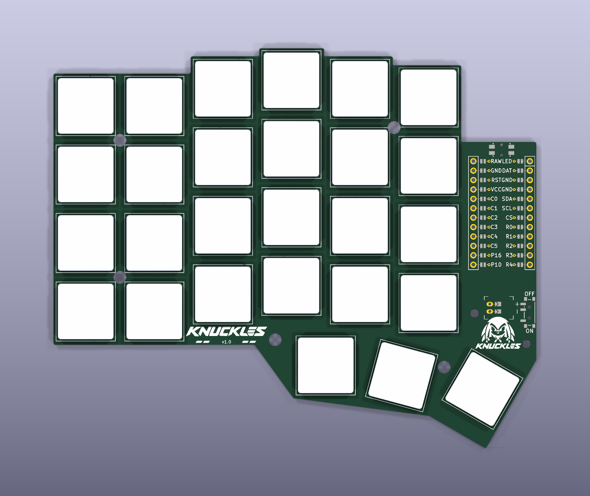

# Knuckles

<p align="center">
  
</p>

There are a lot of split keyboards out there, but most of the ones that piqued
my interest don't have a number row, and I really like having one. I also
wanted a slim ergo split that feels somewhat like a Magic Keyboard. Knuckles is
my attempt at both.


Each half has 27 keys: a column-staggered 6×4 grid that includes the number row,
plus a three-key thumb fan. It uses Kailh PG1316S low-profile switches on
reversible footprints, a nice!nano controller, a JST-PH battery connector, and a
power switch. The controller area also fits the HolyKeebs TPS43 touchpad module.

The first wireless PCB was ordered from JLCPCB on 2026-10-18. The exact files
are archived in [`manufacturing/`](manufacturing/2026-10-18-knuckles-wireless-18.5mm/README.md).



`ergogen/config.yaml` also still defines the original wired `knuckles` board
(TRRS, small display). It's no longer supported. `knuckles_wireless` is the
board to build.

## Build it

You'll need Node.js 18+ (CI uses Node 20) and Git. Footprints live in a
submodule, so clone recursively:

```sh
git clone --recursive https://github.com/fcoury/knuckles.git
cd knuckles
npm install
npm run build
```

`npm run build` runs Ergogen on `ergogen/config.yaml` and writes the PCBs,
plates, outlines, and bottom tray STL. `npm run debug` does the same with
Ergogen's debug output. `npm run watch:build` and `npm run watch:debug` rebuild
whenever the YAML or scripts change.

### Key spacing

The default is 18.5 mm center to center. That's the compact layout and the one
that was ordered. 19.5 mm is also available:

```sh
npm run build -- --spacing 19.5

# Keep both layouts side by side
npm run debug -- --spacing 18.5 --output build/18.5
npm run debug -- --spacing 19.5 --output build/19.5
```

Plates, holes, the silkscreen artwork, and the bottom tray all follow the
selected spacing. Run `npm run build -- --help` for all options. The
[gotchas](#gotchas) cover how spacing interacts with the other scripts.

## Full pipeline

The full pipeline also needs Docker. It runs KiCad 8, KiBot, and Freerouting in
containers, pulling the images on first run.

`./build.sh`:

1. Cleans previous outputs.
2. Runs Ergogen to generate the unrouted board and plates.
3. Exports renders and Gerbers for the plates and unrouted board with KiBot.
4. Exports a DSN, autoroutes it with Freerouting, and imports the SES back into KiCad.
5. Runs KiBot again on the autorouted board.

Other entry points:

- `./rebuild.sh` re-exports and autoroutes the boards already in `pcbs/`
  without running Ergogen.
- `npm run route` autoroutes only `knuckles_wireless`. It prunes dead-end
  traces and tries up to three times. A route is accepted only if KiCad reports
  no unconnected items, no dangling tracks, and no DRC errors.
- `./watch.sh` (macOS, needs `fswatch`) regenerates the PCB when the config
  changes and opens the result.

## Manufacturing

Upload the KiBot ZIP from `ergogen/output/gerbers/knuckles_wireless/` to
JLCPCB. Manufacturing output comes only from
`pcbs/knuckles_wireless_autorouted.kicad_pcb`. The KiBot configs
(`kibot/default.kibot.yaml`, `kibot/boards.kibot.yaml`) are tuned for JLCPCB.
The board uses a 0.25 mm copper-to-edge clearance for routed outlines.

Local builds and CI both route through `scripts/autoroute.sh`, with the same
KiCad image, Freerouting 2.1.0 JAR, rules, and optimizer settings. Freerouting
can still produce different trace geometry from run to run. That's why the
pipeline checks connectivity and DRC instead of comparing files byte for byte.

Each board that gets ordered goes in its own dated folder under
`manufacturing/`. Don't modify those files once they're archived.

## CI

`.github/workflows/build.yaml` runs the full pipeline for both spacings. Each
run uploads a `knuckles-18.5mm` and a `knuckles-19.5mm` artifact containing
cases, Gerbers, images, outlines, and PCBs. `npm test` runs real builds of both
layouts and checks spacing selection, the generated outputs, and rejection of
invalid values.

## Customizing

Everything starts in `ergogen/config.yaml`:

- **Layout:** the key matrix and thumb fan are under `points.zones.*`
  (spacing, splay, stagger).
- **Switches:** set `meta.footprint` and pick a preset (`mx`, `choc_v1`,
  `choc_v2`, or the low-profile reversible footprints).
- **Wiring:** column and row nets are assigned per zone. MCU pins are mapped in
  the `mcu` footprint section.
- **Touchpad:** the TPS43 adapter sits on top of the nice!nano and uses its
  VCC, GND, SDA, and SCL pins, so the PCB doesn't need its own touchpad
  footprint.
- **Case:** edit `cases/knuckles_bottom_tray.jscad` and the
  `outlines/_bottom_case*` outlines to change walls and cutouts.

KiCad project settings in `pcbs/` are generated, so edit
`kicad/projects/knuckles_wireless.kicad_pro` instead. The build copies it next
to the board.

The silkscreen badge and wordmark are documented in
[`artwork/knuckles/`](artwork/knuckles/README.md).

## Repository layout

| Path | Contents |
| --- | --- |
| `ergogen/` | Ergogen config, footprints submodule, generated images and Gerbers |
| `pcbs/` | Generated KiCad boards and plates; `autoroute/<board>/` holds DSN, SES, router log, and DRC report |
| `outlines/` | DXF/SVG outlines for the PCB, plates, and case |
| `cases/` | JSCAD bottom tray and generated STL; `thin/` has slim case prototypes for older 18.5 mm boards |
| `kicad/projects/` | Canonical KiCad project settings |
| `kibot/` | KiBot configs and DSN/SES helper scripts |
| `freerouting/` | Autorouter rules and JAR |
| `manufacturing/` | Archived files for each ordered board |
| `artwork/` | Badge and wordmark sources and PCB renders |
| `images/` | Reference renders of the plates and controller overlay |
| `scripts/` | Build, autoroute, artwork, and case scripts |

## Gotchas

- `--spacing` overrides `KNUCKLES_SPACING`, which overrides the config
  default. The YAML is never rewritten. `pcbs/build-info.json` records which
  spacing was used.
- Changing spacing means you need matching plates and a matching case. Don't
  mix routed boards or Gerbers from different spacing builds.
- `./build.sh` (`KNUCKLES_SPACING=19.5 ./build.sh`) always writes to the root
  output folders. Use `npm run build -- --output` if you want them kept apart.
- `./rebuild.sh` routes whatever board is already in `pcbs/` and keeps its
  spacing.
- `ergogen/output/pcbs/` contains old snapshots that builds don't update.

## License

MIT. See [`LICENSE`](LICENSE).

## Credits

- [Ergogen](https://github.com/ergogen/ergogen) and its community.
- Footprints from [ceoloide](https://github.com/ceoloide/ergogen-footprints)
  (`ergogen/footprints/ceoloide`) and related authors.
- Freerouting for autorouting, KiBot and PCBDraw for renders and exports.
